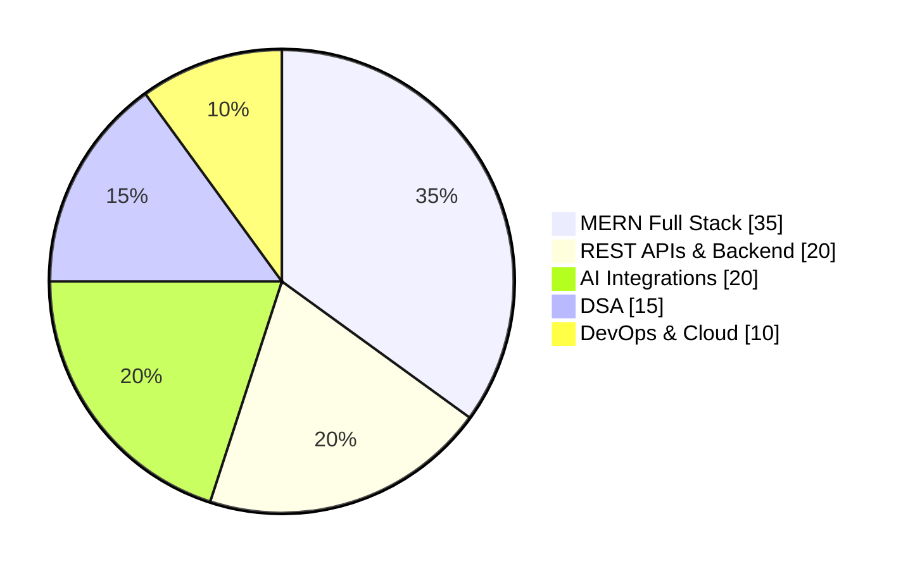
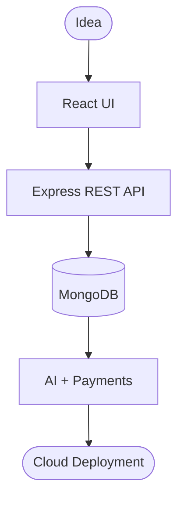

<h1 align="center">Hi, I'm Mayur Kohad 👋</h1>

<h3 align="center">Full Stack MERN Developer · AI Integrations · B.Tech AI &amp; ML</h3>

<p align="center">
  
  
  
  
</p>

<p align="center">
  <a href="https://www.linkedin.com/in/mayur-kohad-developer"></a>
  <a href="mailto:mayurkohad37@gmail.com"></a>
  <a href="https://mayur-project-5bzg.vercel.app/appointment-scheduling"></a>
  <a href="https://leetcode.com/u/Kvw8foAMe6/"></a>
</p>

---

## 👨‍💻 About Me

Full Stack MERN Developer with **7 months of internship experience** building scalable web applications with JavaScript, React.js, Node.js, Express.js and MongoDB. I design REST APIs, integrate AI models (Google Gemini) and payment gateways, and deploy production-ready apps. I have a strong Data Structures and Algorithms foundation and I'm a B.Tech student in AI &amp; Machine Learning.

<table>
<tr>
<td width="55%" valign="top">

```js
const mayur = {
  role: "Full Stack MERN Developer",
  education: "B.Tech AI & ML, Ramdeobaba Univ.",
  experience: "7 months @ Edversity",
  location: "Nagpur, India",
  building: ["AI voice agents", "Payment apps"],
  strengths: ["REST APIs", "AI", "React", "DSA"],
  openTo: "Full Stack / SDE roles",
};
```

</td>
<td width="45%" valign="top">

- 🔭 Building **AI-powered full stack apps**
- ⚙️ Designing **REST APIs** and microservices
- 💳 Integrating **payments** and cloud storage
- 🧠 **100+ DSA problems** solved
- 🏆 **3+ hackathons**, prototypes built in teams
- 🌱 Exploring **LangChain** and **LangGraph**

</td>
</tr>
</table>

---

## 📊 Developer Dashboard

<p align="center">
  
  
  
  
  
</p>

<table>
<tr>
<td width="50%" valign="top">

**Technical focus** *(self-rated, edit to taste)*



</td>
<td width="50%" valign="top">

**How I ship**



</td>
</tr>
</table>

---

## 🛠️ Tech Stack

| | |
|:--|:--|
| **Languages** |     |
| **Frontend** |     |
| **Backend** |      |
| **Databases** |   |
| **AI & Integrations** |       |
| **Data & ML** |   |
| **DevOps & Cloud** |    |
| **Tools** |     |
| **CS Fundamentals** |      |

---

## 💼 Experience

### Full Stack Developer Intern (MERN) · Edversity · *Remote · 7 Months*

- 🧩 Developed and maintained full-stack web apps on the **MERN stack** (MongoDB, Express.js, React.js, Node.js)
- 🎨 Built **responsive, reusable UI components** with React.js, HTML5, CSS3 and JavaScript
- 🔌 Designed and implemented **REST APIs** for efficient client-server communication
- ⚡ Optimized performance through **debugging and code refactoring**
- 🤝 Collaborated with developers using **Git and GitHub** for version control

---

## 🚀 Featured Projects

<table>
<tr>
<td width="33%" valign="top">

### 🎙️ Shifra AI
**Embeddable AI Voice Agent**

 

- Voice agent that can be **embedded into any website**
- Reusable front-end **widget**
- Backend **REST APIs** returning AI-generated responses

</td>
<td width="33%" valign="top">

### 🤖 AI Chatbot App
**Text &amp; Image Generation**

  

- User signup/login, **deployed**
- **Gemini via OpenAI SDK** for text
- **ImageKit** for prompt-based images
- **Payment gateway** with a credit system

</td>
<td width="33%" valign="top">

### 🛒 ShopNest
**Production-Ready E-Commerce**

  

- Auth, catalog, cart and order management
- **Secure online payments**
- **Admin panel** for products and orders
- Cloud image storage, deployed to production

</td>
</tr>
</table>

<p align="center">
  <a href="https://github.com/Mayur-Kohad?tab=repositories"></a>
</p>

---

## 🎓 Education &amp; Certifications

<table>
<tr>
<td width="50%" valign="top">

### 🏫 Education
**B.Tech, Artificial Intelligence &amp; ML**
Ramdeobaba University, Nagpur · *2023 – 2027*
📈 CGPA: **7.7**

`Data Structures` `Machine Learning` `DBMS` `Operating Systems` `Web Development`

</td>
<td width="50%" valign="top">

### 📜 Certifications &amp; Achievements
- ☕ **Java Certification**, LiveTechWire
- 🌐 **MERN Stack Certification**, LiveTechWire
- 🧠 **100+ DSA problems** solved across platforms
- ⚡ **3+ hackathons**, technical prototypes in team environments

</td>
</tr>
</table>

---

## 🤝 Let's Connect

<p align="center">
  I'm open to <b>Full Stack / SDE opportunities</b>. Let's build something great together.
</p>

<p align="center">
  <a href="mailto:mayurkohad37@gmail.com"></a>
  <a href="https://www.linkedin.com/in/mayur-kohad-developer"></a>
</p>
